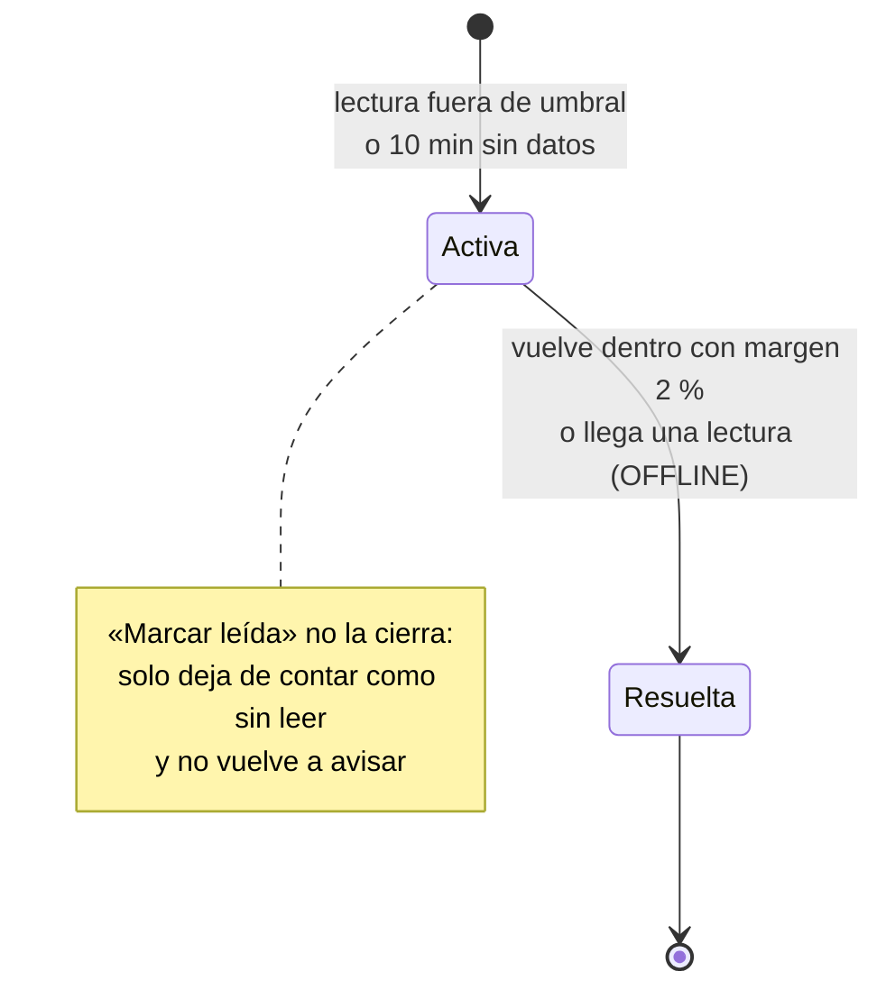

# Contrato de alertas y dashboard (D1, #36)

Código: `demeter/services/alert_rules.py` · Pruebas: `tests/test_alert_rules.py` · Rama: `feature/alertas-contrato`

Este documento fija **cuándo se abre y cuándo se cierra cada alerta** y **qué datos necesitan
el dashboard y la página de alertas**. Lo usan el motor de alertas (D2), la ingesta (A5), el
dashboard (D3), las gráficas (D4), la página de alertas (D5), Telegram (D6) y los tests (D7).

Las reglas ya están en código (funciones puras, sin BD) para que todos usen exactamente las
mismas. Lo que cambia campos de otros (BD, API, tipos de la interfaz) va en la
[sección 8](#8-cambios-de-contrato-que-se-piden) y necesita el visto bueno de su dueño.

## 1. Las reglas en una tabla

| Regla | Valor |
|---|---|
| Abre `LOW` | `valor < umbral_bajo` |
| Abre `HIGH` | `valor > umbral_alto` |
| Valor justo en el umbral | Normal (no abre). Igual que `Sensor.status_for` |
| Duplicados | Como mucho **una alerta activa por sensor y tipo** |
| Cierra `LOW` | `valor >= umbral_bajo + margen` |
| Cierra `HIGH` | `valor <= umbral_alto - margen` |
| Margen (histéresis) | **2 % del rango** del sensor: `0,02 × (umbral_alto − umbral_bajo)`. Con un solo umbral, 2 % de su valor |
| Abre `OFFLINE` | Sensor activo cuya última lectura tiene **10 min o más** |
| Cierra `OFFLINE` | Llega cualquier lectura de ese sensor |
| Comprobación de offline | Cada **60 s** |
| Quién la cierra | Siempre el sistema. El usuario solo la **marca como leída** |

## 2. Ciclo de vida

Una alerta tiene dos ejes independientes:

- **Activa / resuelta**: lo decide el sistema con las reglas de arriba (`resolved_at`).
- **Sin leer / leída**: lo decide la persona con «Marcar leída» (`acknowledged`).



Si después de resolverse el valor se vuelve a salir, se abre **una alerta nueva** (con su
propio aviso). Una alerta leída pero todavía activa no vuelve a avisar.

## 3. Umbrales e histéresis: por qué y con números

Sin margen, un valor que baila alrededor del umbral (24,9 → 25,1 → 24,9…) abriría y cerraría
alertas a cada lectura, con un aviso de Telegram cada vez. Con el margen, una vez abierta la
alerta el valor tiene que **recuperarse de verdad** para cerrarla.

El 2 % es del **rango** y no del umbral para que funcione igual cerca del cero: con helada y
umbral bajo de 2 ºC, el 2 % de 2 ºC serían 0,04 ºC (menos que el ruido del sensor), mientras
que el 2 % de un rango 2–35 ºC son 0,66 ºC.

Márgenes de los sensores de ejemplo de la API (`demeter/api/sample_data.py`):

| Sensor | Umbrales | Margen | `LOW` se cierra en | `HIGH` se cierra en |
|---|---|---|---|---|
| t001 · Temperatura | 8–35 ºC | 0,54 ºC | ≥ 8,54 ºC | ≤ 34,46 ºC |
| h001 · Humedad suelo | 25–60 % | 0,7 % | ≥ 25,7 % | ≤ 59,3 % |
| a001 · Humedad aire | 30–85 % | 1,1 % | ≥ 31,1 % | ≤ 83,9 % |
| l001 · Luminosidad | solo alto: 100 klx | 2 klx | — | ≤ 98 klx |
| d001 · Nivel depósito | solo bajo: 20 % | 0,4 % | ≥ 20,4 % | — |

Con un solo umbral el margen es el 2 % de ese umbral; si el umbral es 0 no hay margen. Ningún
sensor de ejemplo está en ese caso.

Ejemplo, h001 (25–60 %):

| Lectura | Alerta activa antes | Qué pasa |
|---|---|---|
| 26,0 % | — | Nada |
| 24,8 % | — | **Abre `LOW`** · aviso en la app y Telegram |
| 24,6 % | `LOW` | Nada (no se duplica) |
| 25,3 % | `LOW` | Nada: ya está dentro, pero no ha superado 25,7 % |
| 25,7 % | `LOW` | **Cierra `LOW`** |
| 70,0 % | `LOW` | Cierra `LOW` y **abre `HIGH`** en el mismo paso |

Todo esto lo hace `decide(activa, valor, bajo, alto)` en `alert_rules.py`.

## 4. Sensor offline

- Un sensor activo (`is_active = true`) cuya última lectura tiene **10 min o más** abre una
  alerta `OFFLINE` («Sin datos desde hace más de 10 min»).
- La busca una tarea del motor **cada 60 s** (no la ingesta: si no llegan datos, la ingesta
  no se ejecuta).
- Se cierra con la siguiente lectura de ese sensor.
- Un sensor que **nunca** ha enviado datos no es offline: su tarjeta dice «sin datos». Así una
  BD recién creada no se llena de alertas.
- Mientras un sensor está offline, sus alertas `LOW`/`HIGH` **se quedan como estaban**: no
  sabemos si el valor se ha recuperado.

## 5. Casos límite

| Caso | Regla |
|---|---|
| Lectura duplicada (la ingesta la ignora) | No se evalúa |
| Lectura más antigua que la última guardada (backfill B5, reenvíos) | Se guarda, pero **no se evalúa**: el histórico no genera alertas |
| El admin cambia los umbrales | Se aplican desde la siguiente lectura (que puede cerrar o abrir alertas) |
| El admin quita el umbral de un lado | La alerta activa de ese lado se cierra con la siguiente lectura |
| Se desactiva un sensor (`is_active = false`) | Se cierran sus alertas activas y deja de evaluarse |
| Sensor sin umbrales | Nunca abre `LOW`/`HIGH`; sí puede quedar `OFFLINE` |
| Fecha de la alerta | La de la lectura que la abre (para `OFFLINE`, la hora de la comprobación). En UTC; se muestra en hora de Madrid |

## 6. Mensajes

Se generan al abrir la alerta y se guardan. No incluyen el sensor (va en su columna); el
mensaje de Telegram (D6) lo antepone.

| Tipo | Plantilla | Ejemplo |
|---|---|---|
| `LOW` | `{valor} {unidad} por debajo del umbral ({umbral} {unidad})` | `19 % por debajo del umbral (25 %)` |
| `HIGH` | `{valor} {unidad} por encima del umbral ({umbral} {unidad})` | `36 ºC por encima del umbral (35 ºC)` |
| `OFFLINE` | `Sin datos desde hace más de 10 min` | — |

Números con coma decimal y un decimal como mucho (`23,7`, `25`). Telegram:
`⚠ Finca La Costa · Humedad suelo (h001): 19 % por debajo del umbral (25 %)`.

**Avisos (D6):** solo al **abrir** una alerta: aviso emergente (`rx.toast`) en cualquier página
y mensaje a Telegram. Al cerrarse no se avisa (se ve en la página de alertas).

## 7. Qué datos necesita la interfaz

### 7.1 Dashboard (`/dashboard`, wireframe 03)

| Zona | Qué muestra | De dónde sale |
|---|---|---|
| Cabecera | Selector de parcela · «en directo · hace N s» | `GET /api/parcels` · `DashboardSummary.updated_at` |
| Resumen | Sensores ok / en alerta / offline / sin datos | Se cuenta en el estado a partir de `sensors[].status` |
| Tarjetas (una por sensor) | Tipo, último valor + unidad, semáforo, id y umbrales, mini histórico. Clic → `/parcelas/[id]?sensor=` | `DashboardSummary.sensors[]` (`SensorSnapshot`) |
| Alertas recientes | Las **5** más recientes de la parcela, activas primero · «Ver todas» → `/alertas` | `DashboardSummary.alerts` |
| Contador de la barra lateral | Alertas sin leer | `DashboardSummary.unread_alerts` |
| Gemelo 3D y riego | Fuera de D1 (C7 y E5) | `terrain`, `water` |

**Semáforo** (`card_status` en `alert_rules.py`):

| Estado | Color | Cuándo |
|---|---|---|
| `ok` | Verde | Dentro de umbrales |
| `LOW` / `HIGH` | Rojo (con «BAJO» / «ALTO») | Fuera de umbrales |
| `offline` | Gris | Última lectura de hace 10 min o más (gana a los demás) |
| `sin_datos` | Gris claro | Nunca ha enviado datos |

**Refresco:** `GET /api/dashboard?parcel_id=` cada **5 s** en segundo plano (o WebSocket si
llega A7). Si la última respuesta correcta tiene más de 15 s (3 refrescos fallidos), el
indicador pasa de «en directo» a «sin conexión» y se dejan los últimos datos en pantalla.

### 7.2 Forma de `DashboardState` (D3, `state/dashboard_state.py`)

```python
class DashboardState(AuthState):
    # Datos (tipos de demeter/state/types.py)
    parcels: list[Parcel] = []
    parcel_id: int = rx.LocalStorage(...)   # recuerda la última parcela elegida
    sensors: list[SensorSnapshot] = []
    alerts: list[Alert] = []                # las 5 recientes
    unread_alerts: int = 0
    updated_at: str = ""                    # ISO 8601 UTC, del servidor
    last_ok_at: str = ""                    # última respuesta correcta de la API
    loading: bool = False
    error: str = ""

    # Calculados (@rx.var)
    count_ok / count_alert / count_offline / count_no_data -> int
    is_live -> bool                         # last_ok_at hace < 15 s
    seconds_ago -> int                      # para «hace N s»

    # Eventos
    on_load()                               # require_login + carga parcelas + empieza el refresco
    set_parcel(parcel_id: int)              # cambia de parcela y recarga
    refresh()                               # @rx.event(background=True): bucle cada 5 s
```

### 7.3 Página de alertas (`/alertas`, wireframe 05)

| Elemento | Datos |
|---|---|
| Filtros | Sin leer / Todas · tipo (LOW, HIGH, OFFLINE) · parcela · sensor · activas |
| Fila | Estado (sin leer / leída · activa / resuelta), tipo, sensor, mensaje, fecha, «Marcar leída» |
| Paginación | 20 por página · «4 de 37» necesita el total |
| «Marcar todas como leídas» | De la parcela filtrada (o todas) |
| Aviso global | `rx.toast` cuando aparece una alerta con id mayor que la última vista |

### 7.4 Forma de `AlertState` (D5, `state/alert_state.py`)

```python
class AlertState(AuthState):
    alerts: list[Alert] = []
    total: int = 0                          # para «4 de 37»
    unread: int = 0                         # contador de la barra lateral
    last_seen_id: int = 0                   # para lanzar el toast solo con alertas nuevas

    # Filtros
    only_unread: bool = True
    type_filter: str = ""                   # "", "LOW", "HIGH", "OFFLINE"
    parcel_filter: int = 0                  # 0 = todas
    sensor_filter: str = ""
    page: int = 0
    PAGE_SIZE = 20

    # Calculados
    has_prev / has_next -> bool
    range_label -> str                      # «4 de 37»

    # Eventos
    load()                                  # GET /api/alerts con filtros y página
    set_filter(name, value)                 # vuelve a la página 0 y recarga
    next_page() / prev_page()
    acknowledge(alert_id: int)              # PATCH /api/alerts/{id}
    acknowledge_all()                       # «Marcar todas como leídas»
    poll()                                  # lo llama el refresco: actualiza unread y lanza toasts
```

`unread` y el toast viven en `AlertState` (no en el dashboard) porque se ven en todas las
páginas privadas.

## 8. Cambios de contrato que se piden

Afectan a archivos de otros, así que van en una issue con la etiqueta `contrato` y los
implementa cada dueño. Todos son **campos nuevos u opcionales**: no rompen nada de lo que hay.

| # | Cambio | Dónde | Dueño |
|---|---|---|---|
| 1 | `AlertType` admite `"OFFLINE"` | BD · `schemas.py` · `types.py` | David · Alex · Nieto |
| 2 | `Alert` añade `resolved_at` (nulo = activa), `value` y `threshold` (nulos en `OFFLINE`) | BD · `schemas.py` · `types.py` | David · Alex · Nieto |
| 3 | Índice único parcial: una alerta activa por `(sensor_id, type)` `WHERE resolved_at IS NULL` | BD | David |
| 4 | `SensorStatus` admite `"offline"` | `schemas.py` · `types.py` | Alex · Nieto |
| 5 | `SensorSnapshot.recent: list[float]` (últimos 20 valores, para el mini histórico) | `schemas.py` · `types.py` | Alex · Nieto |
| 6 | `GET /api/alerts` añade `type`, `sensor_id`, `active`, `limit` (20), `offset` y la cabecera `X-Total-Count` | API | Alex |
| 7 | `POST /api/alerts/ack-all?parcel_id=` → `{"updated": n}` | API | Alex |
| 8 | `DashboardSummary.alerts` = 5 más recientes, activas primero; `unread_alerts` = todas las sin leer de la parcela | API | Alex |
| 9 | La ingesta (A5) llama al motor después de guardar la lectura, en la misma transacción, y no lo llama con duplicados ni lecturas antiguas | API | Alex |

## 9. Decisiones para la reunión

1. **Margen del 2 % sobre el rango** (no sobre el umbral). Ver la [sección 3](#3-umbrales-e-histéresis-por-qué-y-con-números).
2. **Marcar como leída:** la issue D5 dice `POST /api/alerts/{id}/ack`, pero el contrato de la
   API (A1, ya en `main`) tiene `PATCH /api/alerts/{id}` con `{"acknowledged": true}`.
   Propuesta: **quedarnos con el `PATCH`** y actualizar D5.
3. **Refresco del dashboard:** la issue D3 dice 5 s y el wireframe 03 dice 3 s. Propuesta:
   **5 s** (menos carga, y el simulador no manda más rápido).
4. **¿Quién marca como leída?** El contrato pide rol `tecnico` o superior (`lector` solo ve).
5. **Telegram solo al abrir**, no al cerrar.
6. **El histórico (backfill) no genera alertas.** Si para la demo queremos alertas pasadas,
   el seed (B3) las crea directamente.
