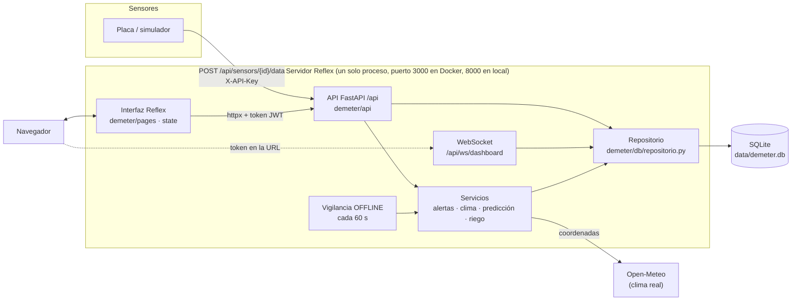

# Arquitectura de Demeter

Documento de referencia para entender cómo encajan las piezas, qué está hecho de verdad y qué
sigue siendo de ejemplo. Los detalles de cada pieza están en sus propios documentos (enlazados).

- [Contrato de la API](api-contrato.md) · [Modelo de datos](modelo-datos.md) ·
  [Repositorio](repositorio-contrato.md) · [Alertas](alertas-contrato.md) ·
  [Predicción y riego](insights-contrato.md) · [Diseño de la interfaz](diseno.md)

## 1. Visión general

Demeter recoge lecturas de sensores de parcela (temperatura, humedad del suelo, luminosidad,
humedad ambiente, nivel del depósito), las guarda, avisa cuando algo se sale de sus umbrales y lo
enseña en un panel web. Es **un solo proceso Python**: Reflex sirve la interfaz y, dentro del
mismo servidor, monta la API REST (FastAPI) y una tarea en segundo plano que vigila los sensores.



## 2. Capas y quién es dueño de qué

| Capa | Carpeta | Qué hace | Dueño |
|---|---|---|---|
| Interfaz | `demeter/pages`, `demeter/components`, `demeter/state`, `demeter/theme.py` | Páginas Reflex y sesión del usuario. Hablan con la API por HTTP, nunca con la BD | Nieto |
| API | `demeter/api` | Rutas REST, validación (`schemas.py`), login y roles (`auth.py`, `security.py`), WebSocket | Alex |
| Servicios | `demeter/services` | Reglas de negocio: motor de alertas, clima, predicción a 24 h, recomendador de riego | Luna (alertas), Mario H. (predicción, riego), Alex (clima) |
| Repositorio | `demeter/db/repositorio.py` | Único sitio que consulta la BD para la API. Devuelve esquemas de la API, no filas | David |
| Modelos y BD | `demeter/models`, `demeter/db/conexion.py`, `seed.py`, `alembic/` | Tablas SQLModel, migraciones, datos de ejemplo | David |

**Regla que mantiene todo ordenado:** la interfaz solo conoce la API, la API solo conoce el
repositorio y los servicios, y solo el repositorio y el motor de alertas tocan la base de datos.
`CODEOWNERS` fija quién revisa cada carpeta.

## 3. Cómo arranca

`rxconfig.py` define la app y la URL de la BD. `demeter/demeter.py` crea la `rx.App` y le pasa la
API como `api_transformer`, por eso `/api/...` y `/docs` salen del mismo servidor que la interfaz.
Al arrancar la API (`lifespan` en `demeter/api/app.py`) se lanza la vigilancia de sensores OFFLINE.

```bash
reflex db migrate            # crea las tablas (Alembic)
python -m demeter.db.seed    # 3 fincas, 14 sensores y 3 usuarios de ejemplo
reflex run                   # interfaz + API
docker compose up --build    # lo mismo en un contenedor, con la BD en un volumen
```

Si la BD no está preparada, las rutas que la usan responden **503** con lo que hay que ejecutar.

## 4. El camino de una lectura

1. La placa (o el simulador) hace `POST /api/sensors/{id}/data` con la cabecera `X-API-Key`. El
   `timestamp` es opcional (una placa sin reloj no lo manda y se usa la hora de llegada); si
   viene, debe estar entre 24 h atrás y 5 min por delante.
2. La API guarda la lectura con `save_reading(..., session=...)`. Una lectura repetida (mismo
   sensor y hora) no es un error: se ignora y devuelve `duplicate: true`.
3. **En la misma transacción** llama al motor de alertas (`evaluar_lectura`), que abre una alerta
   `LOW`/`HIGH` al salirse de los umbrales, la cierra con histéresis al normalizarse y cierra la
   `OFFLINE` si el sensor volvía a dar señal. Un duplicado, una lectura atrasada o un sensor de
   baja no generan alertas. La lectura y sus alertas se guardan juntas o no se guarda nada.
4. Cada 60 s la vigilancia abre una alerta `OFFLINE` en los sensores activos que llevan 10 min o
   más sin datos. Un sensor que nunca ha enviado nada se muestra como «sin datos», no `OFFLINE`.
5. El panel pide `GET /api/dashboard` o, mejor, abre el WebSocket y recibe el resumen cada vez
   que cambia algo.

El **histórico** (`POST /api/sensors/{id}/data/batch`, hasta 1000 lecturas, todo o nada) usa la
misma ruta de guardado pero **nunca genera alertas**: es historia, no lo que pasa ahora.

## 5. Seguridad

- **Usuarios:** login con `POST /api/auth/login` (nombre de usuario único). Contraseñas con
  bcrypt (máx. 72 bytes); token JWT HS256 de 60 min que solo lleva el id. El rol y si el usuario
  sigue activo se leen **en cada petición**, así que una baja o un cambio de rol valen al instante.
  El login tarda lo mismo exista o no el usuario.
- **Roles:** `lector` (solo mira), `tecnico` (edita terreno, costes y coloca sensores) y `admin`
  (todo, incluidas bajas de parcelas y umbrales). Hay una prueba que recorre **todas** las rutas
  de `/openapi.json` y falla si una ruta de escritura nueva no declara sus permisos.
- **Sensores:** la ingesta no usa usuario sino la cabecera `X-API-Key` (`DEMETER_INGEST_KEY`),
  comparada en tiempo constante. Un token de usuario, aunque sea de admin, no vale para ingerir.
- **WebSocket:** el navegador no puede poner cabeceras, así que el JWT va en la URL; se cierra
  con código 1008 si el token no vale, caduca o el usuario es dado de baja.
- **Secretos:** `DEMETER_JWT_SECRET` (sin él se genera uno al arrancar y los tokens caducan al
  reiniciar). El valor de ejemplo de `.env.example` se rechaza con un aviso.
- **Privacidad:** a Open-Meteo solo salen las coordenadas de la parcela redondeadas a 2 decimales.

## 6. Decisiones de diseño cerradas

- **Baja, no borrado.** Desactivar una parcela desactiva todos sus sensores; reactivarla los
  reactiva. Quien no es admin no ve lo dado de baja (404). Se conservan las lecturas.
- **Una BD, SQLite.** Un fichero, sin servidor. El código usa un `INSERT … ON CONFLICT DO NOTHING`
  específico de SQLite para que una lectura repetida no estropee la transacción.
- **Los datos simulados se dicen simulados.** Nada se inventa sin avisar: si no hay clima real,
  la API responde 503 / `weather: null` en vez de un valor de ejemplo.
- **El repositorio devuelve esquemas de la API** y abre una sesión por llamada, salvo si quien llama
  le pasa la suya para hacer varias cosas en una transacción (lectura + alertas).
- **Telegram solo al abrir una alerta**, no al cerrarla. El histórico no avisa.
- **Un solo sondeo del WebSocket:** el servidor mira la BD cada 2 s y solo envía si cambió algo.
  Es suficiente con un proceso y SQLite; si algún día hace falta que sea instantáneo, habría que
  avisar desde la ingesta.

## 7. Qué está hecho de verdad y qué es de ejemplo

| Área | Estado |
|---|---|
| Parcelas, sensores, umbrales, baja en cascada | **BD** |
| Lecturas: ingesta, histórico, consulta | **BD** |
| Alertas (motor, listado, leer, «leer todas») y dashboard | **BD** |
| WebSocket del dashboard | **BD** |
| Clima y previsión | **Real** (Open-Meteo, con caché y reserva) |
| Login y usuarios (alta, roles, baja) | **BD** (`DbUserStore`); entrada por usuario o por correo |
| Predicción a 24 h y consejo de riego | Cálculo real sobre **datos de ejemplo** |
| Terreno, zonas, elementos, depósitos y agua, costes | **Ejemplo** (solo fincas 1 y 2) |

Consecuencia visible: `/api/parcels/3/terrain`, `/water`, `/irrigation` y `/transactions` dan 404
para la finca 3 aunque el dashboard y el clima ya la sirven. Se resuelve con los modelos y datos
del terreno 3D (David) y los endpoints de terreno y agua (Alex).

## 8. Variables de entorno

| Variable | Para qué | Por defecto |
|---|---|---|
| `DEMETER_DATABASE_URL` | BD | `sqlite:///data/demeter.db` |
| `DEMETER_INGEST_KEY` | Clave de los sensores (`X-API-Key`) | `demo-ingest-key` |
| `DEMETER_JWT_SECRET` | Firma de los tokens | aleatorio al arrancar |
| `DEMETER_JWT_MINUTES` | Duración del token | `60` |
| `DEMETER_WEATHER_URL` | Servidor del clima | Open-Meteo |
| `DEMETER_SEED` | Rellenar con datos de ejemplo al arrancar en Docker | `1` en `docker-compose.yml` |
| `DEMETER_SIN_VIGILANCIA` | `1` desactiva la vigilancia OFFLINE (pruebas) | no definida |

## 9. Pruebas

`pytest` ejecuta todo con una BD en memoria y el seed (`tests/conftest.py`) y sin tocar internet
(el clima falla salvo que la prueba lo simule). La cobertura de `demeter/api` es del 96 %.

## 10. Límites conocidos y siguientes pasos

- **Un solo proceso y SQLite.** Para varios servidores haría falta otro motor y un aviso entre
  procesos en el WebSocket.
- **Claves de ingesta:** hoy hay una global. El plan es una clave por dispositivo (placa) y un
  endpoint por lotes por dispositivo; la placa pertenecería a una parcela.
- **Registro con correo (con verificación) y login con Google:** el repositorio ya lo soporta
  (`get_user_by_email`, `get_user_by_google_sub`); falta la API.
- **Compartir parcelas** entre usuarios (visores o miembros): pendiente de decidir con el equipo.
