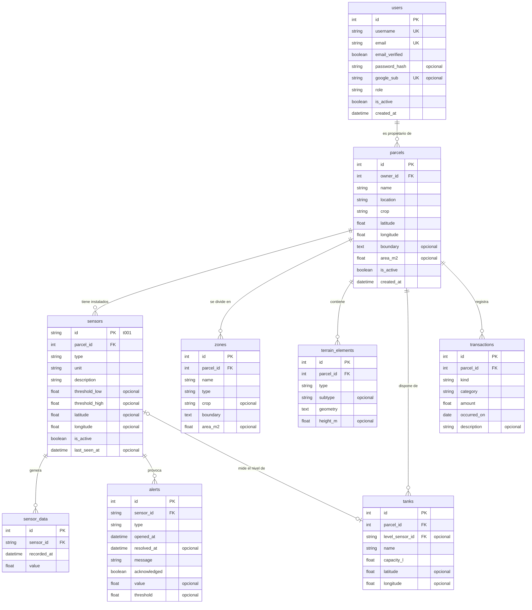

# Modelo de datos — Demeter

> **Versión:** 1.1
> **Estado:** definitivo. Diseño cerrado con Alex (API), Nieto (interfaz), Mario L. (alertas) y Mario H. (datos). Cualquier cambio posterior se hace con una versión nueva y aviso al equipo. La 1.1 cambia solo `users` (acceso con Google y registro con verificación de correo, acordado con Alex)
> **Tarjetas:** #11 [B1] y la idea "Modelo de datos del terreno 3D"
> **Rama:** `feature/db-users-v1-1` · **Autor:** David · **Fecha:** 23/11/2026

Este documento describe las nueve tablas de la aplicación, cómo se relacionan y
por qué se han diseñado así. Las tablas son el contrato que comparte todo el
equipo: cualquier cambio de nombre o de columna debe avisarse antes de hacerse.

Está alineado con el contrato de la API (`docs/api-contrato.md` y
`demeter/api/schemas.py`) y con el contrato de alertas
(`docs/alertas-contrato.md`). Donde la base de datos y la API usan nombres
distintos, se indica en la sección 6.

**Cambios respecto a la versión 1.0**

- `users` admite tres formas de entrar: usuario y contraseña, registro con
  correo verificado y cuenta de Google. Alex lo propone y el equipo lo acepta.
- `password_hash` pasa a ser opcional (quien entra solo con Google no tiene
  contraseña).
- Nuevo `google_sub`, único y opcional: identificador de la cuenta de Google.
- `email` pasa a ser obligatorio y único, y se guarda siempre en minúsculas.
- Nuevo `email_verified`, falso hasta que se pulsa el enlace del correo.
- Una restricción de la base de datos exige que cada usuario tenga contraseña
  o cuenta de Google.
- Las otras ocho tablas no cambian.

**Cambios respecto a la versión 0.4**

- Se descarta Telegram para las alertas: `users` no necesita ninguna columna
  de mensajería (Mario L.).
- Las predicciones a 24 h y el reparto de agua se calculan al vuelo, así que no
  hay tabla nueva (Mario H.). Si más adelante se quiere un histórico de
  consejos, se añadirá una tabla `irrigation_advice`.
- Los modelos en código irán en `demeter/models/`.
- Todo el equipo confirma que dar de baja es desactivar, no borrar.
- Mario L. propone una lectura cada 5 minutos en vez de cada minuto; se
  indican las dos cifras de volumen. La decisión no afecta a las tablas.
- Se retira la sección de preguntas abiertas. Las dos que quedaban (frecuencia
  de lecturas y si al desactivar una parcela se desactivan sus sensores)
  afectan al simulador, a la regla `OFFLINE` y a la API, no a las tablas.
- Resueltas y retiradas las preguntas sobre Telegram y sobre las predicciones.

**Cambios respecto a la versión 0.3**

- `parcels`: se añade `is_active`, para poder dar de baja una parcela sin
  borrarla (petición de Alex).
- Se acuerda con Alex que dar de baja es desactivar, no borrar (decisión 24).
- Alex indica que los sensores envían una lectura por minuto; se añade el
  cálculo de volumen de `sensor_data`.
- Nuevas preguntas abiertas: qué pasa con los sensores de una parcela
  desactivada, a dónde van los avisos de Telegram y si las predicciones se
  guardan. Las dos últimas podrían añadir una columna o una tabla.

**Cambios de la versión 0.2 a la 0.3**

- `users`: se entra con `username` (único y obligatorio); `email` pasa a ser
  opcional; se elimina `name`.
- `sensors`: la clave primaria es el código de texto del reto (`"t001"`), y la
  columna `name` pasa a llamarse `description`.
- `sensor_data`, `alerts` y `tanks` apuntan al sensor con ese código de texto.
- Tipos de sensor en español, como en el reto y la interfaz.
- `sensor_data`: el índice (`sensor_id`, `recorded_at`) pasa a ser único, para
  rechazar lecturas duplicadas.
- `alerts`: se añade el tipo `OFFLINE`; se añaden `message` y `acknowledged`;
  `closed_at`, `trigger_value` y `threshold_value` pasan a llamarse
  `resolved_at`, `value` y `threshold`; y un índice único parcial impide dos
  alertas activas del mismo sensor y tipo (petición de Mario L.).
- `parcels.latitude` y `longitude` son obligatorias (origen del editor 3D).

## 1. Visión general

| Tabla | Qué guarda | Bloque | Prioridad |
|---|---|---|---|
| `users` | Personas que entran en la aplicación | Núcleo | Imprescindible |
| `parcels` | Fincas monitorizadas | Núcleo | Imprescindible |
| `sensors` | Aparatos de medida instalados | Núcleo | Imprescindible |
| `sensor_data` | Lecturas de los sensores | Núcleo | Imprescindible |
| `alerts` | Avisos del motor de alertas | Núcleo | Imprescindible |
| `zones` | Zonas de cultivo y de no cultivo | Terreno 3D | Alta (mínimo de la demo) |
| `terrain_elements` | Árboles, bancales y caminos | Terreno 3D | Alta (mínimo de la demo) |
| `tanks` | Depósitos de agua | Terreno 3D | Media (extra) |
| `transactions` | Costes e ingresos | Terreno 3D | Baja (extra) |

## 2. Diagrama entidad-relación

Lectura del diagrama: un usuario tiene muchas parcelas. De cada parcela cuelgan
sus sensores, zonas, elementos de terreno, depósitos y movimientos económicos.
Cada sensor genera muchas lecturas y muchas alertas. Un depósito puede tener
asociado un sensor que mide su nivel.

## 3. Tablas del núcleo

### 3.1 `users`

Personas que pueden entrar en la aplicación.

| Columna | Tipo | Oblig. | Qué guarda |
|---|---|---|---|
| `id` | entero | Sí | Identificador único (clave primaria) |
| `username` | texto | Sí | Nombre con el que se inicia sesión. Único y **sin el carácter `@`**. Quien entra con Google recibe uno generado a partir de su correo |
| `email` | texto | Sí | Correo. Único y siempre en minúsculas, para que `Ana@x.com` y `ana@x.com` no sean dos cuentas |
| `email_verified` | booleano | Sí | Falso hasta que la persona pulsa el enlace del correo. Es independiente de `is_active` |
| `password_hash` | texto | No | Contraseña cifrada con bcrypt. Nunca en claro. Vacío si solo entra con Google |
| `google_sub` | texto | No | Identificador de su cuenta de Google. Único. Vacío si no usa Google |
| `role` | texto | Sí | `admin`, `tecnico` o `lector` |
| `is_active` | booleano | Sí | Si es falso, no puede entrar. Permite desactivar sin borrar |
| `created_at` | fecha y hora | Sí | Fecha de alta (UTC) |

**Restricción:** cada usuario debe tener `password_hash` o `google_sub` (o los
dos). Lo impone la propia base de datos, porque un usuario sin ninguno de los
dos no podría entrar nunca.

**Reglas que cumple el código que escribe en `users`** (la base de datos no las
comprueba):

- `email` se pasa a minúsculas antes de guardar.
- `username` no puede contener `@`. El login acepta usuario o correo en el mismo
  campo; si un usuario pudiera llamarse como el correo de otro, los dos
  quedarían en conflicto al entrar.
- Las cuentas de Google se enlazan **solo por `google_sub`**, nunca por correo.
  Si no, alguien podría registrarse con el correo de otra persona y quedarse
  con su cuenta.

### 3.2 `parcels`

Fincas monitorizadas.

| Columna | Tipo | Oblig. | Qué guarda |
|---|---|---|---|
| `id` | entero | Sí | Identificador único (clave primaria) |
| `owner_id` | entero | Sí | `id` del usuario propietario (clave foránea a `users`) |
| `name` | texto | Sí | Nombre de la finca |
| `location` | texto | Sí | Municipio o paraje, para mostrar en listas |
| `crop` | texto | Sí | Cultivo principal (aguacate, mango, tomate…) |
| `latitude` | decimal | Sí | Latitud del centro. Origen de coordenadas del editor 3D |
| `longitude` | decimal | Sí | Longitud del centro |
| `boundary` | texto | No | Contorno de la parcela: polígono en GeoJSON |
| `area_m2` | decimal | No | Superficie en metros cuadrados, calculada en el servidor |
| `is_active` | booleano | Sí | Si la parcela está en servicio. Darla de baja es desactivarla, no borrarla |
| `created_at` | fecha y hora | Sí | Fecha de alta (UTC) |

### 3.3 `sensors`

Aparatos instalados en una parcela. Cada sensor mide una sola magnitud.

| Columna | Tipo | Oblig. | Qué guarda |
|---|---|---|---|
| `id` | texto | Sí | Código del sensor, formato del reto (`"t001"`). Clave primaria |
| `parcel_id` | entero | Sí | `id` de la parcela (clave foránea a `parcels`) |
| `type` | texto | Sí | Qué mide. Lista cerrada (ver sección 5) |
| `unit` | texto | Sí | Unidad de medida. La asigna el código según `type` |
| `description` | texto | Sí | Texto corto para mostrar ("Estación norte"). Puede ir vacío |
| `threshold_low` | decimal | No | Por debajo de este valor se abre una alerta `LOW` |
| `threshold_high` | decimal | No | Por encima de este valor se abre una alerta `HIGH` |
| `latitude` | decimal | No | Dónde está instalado. Se introduce a mano |
| `longitude` | decimal | No | Ídem |
| `is_active` | booleano | Sí | Si está en servicio |
| `last_seen_at` | fecha y hora | No | Momento de su última lectura (UTC). Vacío = nunca ha enviado datos, y entonces no cuenta como caído |

### 3.4 `sensor_data`

Lecturas recibidas. Es la tabla con más filas del sistema.

| Columna | Tipo | Oblig. | Qué guarda |
|---|---|---|---|
| `id` | entero | Sí | Identificador único (clave primaria) |
| `sensor_id` | texto | Sí | Código del sensor (clave foránea a `sensors`) |
| `recorded_at` | fecha y hora | Sí | Cuándo se tomó la medida (UTC), no cuándo se guardó |
| `value` | decimal | Sí | Valor medido |

**Índice único** sobre (`sensor_id`, `recorded_at`), en ese orden. Acelera las
consultas por sensor y rango de fechas, e impide guardar dos veces la misma
lectura.

**Volumen estimado con 14 sensores:**

| Frecuencia | Lecturas al día | Lecturas cada 30 días |
|---|---|---|
| Una por minuto | unas 20.000 | unas 600.000 |
| Una cada 5 minutos | unas 4.000 | unas 120.000 |

SQLite lo soporta bien en los dos casos con el índice anterior.

### 3.5 `alerts`

Avisos generados por el motor de alertas. Una alerta se abre, dura un tiempo y
se resuelve. Las reglas exactas están en `docs/alertas-contrato.md`.

| Columna | Tipo | Oblig. | Qué guarda |
|---|---|---|---|
| `id` | entero | Sí | Identificador único (clave primaria) |
| `sensor_id` | texto | Sí | Código del sensor (clave foránea a `sensors`) |
| `type` | texto | Sí | `LOW`, `HIGH` u `OFFLINE` |
| `opened_at` | fecha y hora | Sí | Cuándo se abrió (UTC) |
| `resolved_at` | fecha y hora | No | Cuándo la resolvió el sistema. Vacío = sigue activa |
| `message` | texto | Sí | Texto del aviso, generado al abrir la alerta |
| `acknowledged` | booleano | Sí | Si una persona la ha marcado como leída. Por defecto, falso |
| `value` | decimal | No | Valor que la disparó. Vacío en `OFFLINE` |
| `threshold` | decimal | No | Umbral vigente en ese momento. Vacío en `OFFLINE` |

**Índice único parcial** sobre (`sensor_id`, `type`), solo para las filas con
`resolved_at` vacío. Garantiza en la propia base de datos que un sensor tiene,
como mucho, una alerta activa de cada tipo. Sirve también para localizar rápido
la alerta activa de un sensor.

## 4. Tablas del terreno 3D

### 4.1 `zones`

Partes en que se divide una parcela.

| Columna | Tipo | Oblig. | Qué guarda |
|---|---|---|---|
| `id` | entero | Sí | Identificador único (clave primaria) |
| `parcel_id` | entero | Sí | `id` de la parcela (clave foránea a `parcels`) |
| `name` | texto | Sí | Nombre de la zona |
| `type` | texto | Sí | `crop` (cultivo) o `no_crop` (no cultivo) |
| `crop` | texto | No | Qué se cultiva, si es zona de cultivo |
| `boundary` | texto | Sí | Contorno de la zona: polígono en GeoJSON |
| `area_m2` | decimal | No | Superficie, calculada en el servidor |

### 4.2 `terrain_elements`

Objetos que se colocan en el editor 3D. Los sensores **no** están aquí: se leen
de la tabla `sensors`.

| Columna | Tipo | Oblig. | Qué guarda |
|---|---|---|---|
| `id` | entero | Sí | Identificador único (clave primaria) |
| `parcel_id` | entero | Sí | `id` de la parcela (clave foránea a `parcels`) |
| `type` | texto | Sí | `tree` (árbol), `terrace` (bancal) o `path` (camino) |
| `subtype` | texto | No | Detalle: aguacate, mango, chirimoya… |
| `geometry` | texto | Sí | Forma en GeoJSON: punto, línea o polígono |
| `height_m` | decimal | No | Altura en metros, para el 3D |

### 4.3 `tanks`

Depósitos de agua. Puede haber varios por parcela.

| Columna | Tipo | Oblig. | Qué guarda |
|---|---|---|---|
| `id` | entero | Sí | Identificador único (clave primaria) |
| `parcel_id` | entero | Sí | `id` de la parcela (clave foránea a `parcels`) |
| `level_sensor_id` | texto | No | Código del sensor que mide su nivel (clave foránea a `sensors`) |
| `name` | texto | Sí | Nombre del depósito ("Balsa norte") |
| `capacity_l` | decimal | Sí | Capacidad en litros |
| `latitude` | decimal | No | Dónde está |
| `longitude` | decimal | No | Ídem |

El nivel actual no es una columna: es la última lectura del sensor asociado, en
porcentaje. Los litros disponibles son `capacity_l × nivel / 100`.

### 4.4 `transactions`

Costes e ingresos de una parcela.

| Columna | Tipo | Oblig. | Qué guarda |
|---|---|---|---|
| `id` | entero | Sí | Identificador único (clave primaria) |
| `parcel_id` | entero | Sí | `id` de la parcela (clave foránea a `parcels`) |
| `kind` | texto | Sí | `income` (ingreso) o `expense` (gasto) |
| `category` | texto | Sí | Concepto: agua, abono, venta… |
| `amount` | decimal | Sí | Importe en euros, siempre positivo |
| `occurred_on` | fecha | Sí | Día del movimiento |
| `description` | texto | No | Nota libre |

## 5. Valores de las listas cerradas

| Campo | Valores |
|---|---|
| `users.role` | `admin`, `tecnico`, `lector` |
| `sensors.type` (unidad) | `temperatura` (ºC), `humedad_suelo` (%), `luminosidad` (klx), `humedad_ambiente` (%), `nivel_deposito` (%) |
| `alerts.type` | `LOW`, `HIGH`, `OFFLINE` |
| `zones.type` | `crop`, `no_crop` |
| `terrain_elements.type` | `tree`, `terrace`, `path` |
| `transactions.kind` | `income`, `expense` |

Son los mismos valores que `demeter/api/schemas.py` (a falta de que Alex y Nieto
añadan `OFFLINE`, según el contrato de alertas). Si se añade uno, hay que
cambiarlo en todos los sitios.

## 6. Correspondencia con la API

La base de datos y la API coinciden en casi todo. Estas son las excepciones; la
traducción la hace la capa de repositorio (#13):

| Base de datos | API | Motivo |
|---|---|---|
| `sensor_data.recorded_at` | `Reading.timestamp` | `timestamp` es palabra reservada en algunos motores, y `recorded_at` deja claro que es el momento de la medida |
| `alerts.opened_at` | `Alert.timestamp` | La alerta tiene dos fechas (apertura y resolución); el nombre distingue cuál es |
| `users.password_hash` | (nunca se expone) | Seguridad |
| `users.google_sub` | (nunca se expone) | Es un identificador interno de la cuenta de Google |

`alerts.resolved_at`, `value` y `threshold` se llaman igual en la base de datos
y en la API.

## 7. Decisiones de diseño

**Núcleo**

1. **Una parcela, un propietario.** Se usa `owner_id`. Los roles son globales,
   y además el propietario puede editar su parcela y su terreno.
2. **Se entra con `username`, y también con el correo.** Es lo que usan el
   contrato de la API y la interfaz; el login acepta usuario o correo en el
   mismo campo. El correo es obligatorio y único (versión 1.1).
3. **El código del reto es la clave del sensor.** `"t001"` se guarda tal cual
   como clave primaria, sin traducción entre la API y la base de datos. Las
   claves foráneas que apuntan al sensor también son texto. Inconveniente
   aceptado: cambiar el código de un sensor obligaría a cambiar todas sus
   lecturas, así que el código no debe cambiar nunca.
4. **Un sensor, una magnitud.** Una estación que mida temperatura y humedad se
   registra como dos sensores. Así cada lectura es un único número.
5. **Umbrales en `sensors`.** Dependen del cultivo y se editan desde la web,
   por lo que no pueden estar fijos en el código.
6. **`last_seen_at` guardado, no calculado.** El motor busca sensores caídos
   cada 60 segundos; hacerlo buscando la última lectura en una tabla enorme
   sería costoso. Solo debe avanzar: una lectura antigua (histórico o reenvío)
   no lo retrocede.
7. **`recorded_at` es el momento de la medida.** Permite lecturas que llegan
   con retraso y la carga de 30 días de histórico (#16).
8. **Índice único (`sensor_id`, `recorded_at`).** Casi todas las consultas son
   "las lecturas de este sensor entre dos fechas", y la ingesta debe ignorar
   lecturas repetidas.
9. **Alertas con fecha de resolución.** Activa o resuelta se deduce de
   `resolved_at`; no hay una columna de estado que pueda contradecirla.
10. **"Leída" y "resuelta" son cosas distintas.** `acknowledged` lo marca una
    persona; `resolved_at` lo decide el sistema cuando el valor se normaliza o
    el sensor vuelve a enviar datos.
11. **Una alerta activa por sensor y tipo, garantizado por la base de datos.**
    Un índice único parcial lo impide aunque falle el código del motor.
12. **La alerta guarda el valor y el umbral**, además del mensaje, para que
    siga explicando por qué saltó aunque el umbral cambie después.
13. **La alerta no guarda la parcela.** Se obtiene a través del sensor.
14. **Fechas en UTC.** Evita horas duplicadas o inexistentes en los cambios de
    hora. La conversión a hora local se hace al mostrar.

**Terreno 3D**

15. **Coordenadas en latitud y longitud (WGS84).** Todas las formas se guardan
    en GeoJSON, con el orden `[longitud, latitud]`. El editor 3D convierte a
    metros tomando como origen el centro de la parcela, y al guardar vuelve a
    convertir.
16. **Los sensores viven solo en `sensors`.** El editor 3D los lee de ahí; no
    se duplican como elementos de terreno.
17. **Una sola tabla para árboles, bancales y caminos.** GeoJSON admite punto,
    línea y polígono en una misma columna `geometry`.
18. **El nivel del depósito es un sensor** de tipo `nivel_deposito`, en
    porcentaje. Reutiliza el histórico, las gráficas, las alertas y el
    simulador sin construir nada aparte.
19. **Sin altura para sensores ni depósitos.** El terreno es plano y el modelo
    3D ya tiene su tamaño.
20. **`area_m2` se guarda aunque se calcule.** La calcula el servidor a partir
    del contorno y debe actualizarse cada vez que este cambie.
21. **`amount` siempre positivo.** El signo lo indica `kind`.

**Generales**

22. **SQLite.** Sin dependencias externas: funciona sin conexión en la demo.
    No se usa ningún tipo exclusivo, por lo que podría pasarse a PostgreSQL.
    El índice parcial de `alerts` existe en ambos.
23. **Nombres de tablas y columnas en inglés y `snake_case`.** Los valores de
    las listas cerradas siguen el reto y el contrato de la API.
24. **Dar de baja es desactivar, no borrar.** `users`, `parcels` y `sensors`
    tienen `is_active`. El histórico (lecturas y alertas) se conserva siempre.
    Confirmado por todo el equipo.
25. **Sin Telegram.** Las alertas no se envían por Telegram, así que `users` no
    guarda ningún dato de mensajería.
26. **Predicciones y reparto de agua al vuelo, sin tabla.** Dependen del último
    dato y de la previsión de lluvia; un resultado guardado quedaría viejo en
    una hora. La única tabla futura prevista es `irrigation_advice`, si se
    quiere histórico de consejos.
27. **Tres formas de entrar, un solo usuario.** Usuario y contraseña (camino
    principal, funciona sin conexión), registro con correo verificado y
    cuenta de Google (estos dos necesitan internet). Una misma fila de `users`
    sirve para los tres, por eso `password_hash` y `google_sub` son opcionales.
28. **`is_active` y `email_verified` son cosas distintas.** El primero lo decide
    un administrador (dar de baja); el segundo lo decide el correo. Si se
    usara `is_active` para "pendiente de verificar", un usuario dado de baja
    podría reactivarse solo pulsando el enlace de su correo.
29. **Google se enlaza solo por `google_sub`.** Nunca por correo, para que nadie
    pueda quedarse con la cuenta de otra persona registrándose con su correo.
30. **Registro abierto: siempre `lector`.** Un usuario nuevo no puede ser
    `tecnico` ni `admin`; el rol lo sube un administrador. Que cada usuario
    tenga sus propias parcelas queda fuera de esta versión (de momento ven las
    de ejemplo, en solo lectura).
